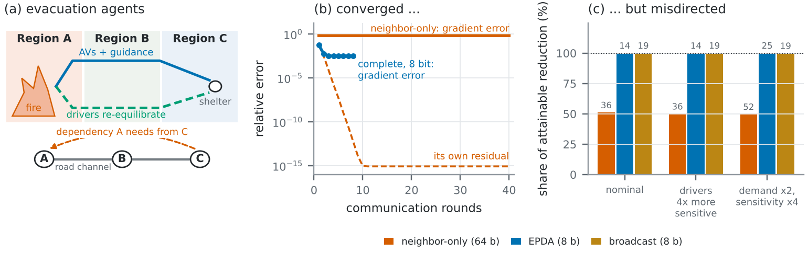

<h1 align="center">Beyond Road Neighbors</h1>

<p align="center"><b>Preserving cross-region AV coordination under limited communication</b><br>
Luyao Niu &middot; Ruolin Li &middot; University of Southern California</p>

<p align="center">
<a href="#install"></a>
<a href="LICENSE"></a>
<a href="#reproduce-the-paper"></a>
</p>

<p align="center"></p>

During a wildfire evacuation, regional authorities route the autonomous vehicles (AVs) leaving
their regions and issue route guidance, while human drivers re-equilibrate across all regions.
Each authority needs a gradient that passes through the drivers' equilibrium, and the
information that gradient depends on is spread over every region its evacuees cross.
**Which information must the authorities exchange, and how precisely?**

Exchanging with road neighbors fails silently. On Anaheim with 16 authorities the distributed
computation converges to machine precision while its gradient is 68% wrong, and the team
realizes half of the attainable reduction in exposure-weighted travel time (panel b, c above).
This repository contains the method, the theory checks and every experiment of the paper:

- **Coverage.** Implicit differentiation of the driver equilibrium splits the team gradient into
  regional contributions and yields a dependency graph $G_{\rm dep}$ that each authority computes
  from its own routes. A protocol that omits part of it solves a different linear system; its
  error is pinned between bounds set by the *omitted flux*, and no further rounds or bits remove it.
- **Precision.** Once $G_{\rm dep}$ is covered, the drivers' entropy term is an owner-held
  preconditioner: the spectrum of $N^{-1}A$ lies in $[1, 1+\gamma]$ with a computable $\gamma$,
  which gives round certificates in advance and an a posteriori error certificate afterwards.
- **EPDA**, the entropy-preconditioned distributed adjoint method, exchanges sensitivity-weighted
  products along $G_{\rm dep}$ and keeps raw flows local. With 8-bit messages it retains 96–100%
  of the full-information improvement in two to four rounds, on direct channels or relayed over
  road channels, while two- and three-hop exchange spends 17 to 50 times its payload and still
  falls short.

## Main result

Anaheim, 16 authorities, 30 decision steps from a common start. Retention of the reference
reduction of exposure-weighted travel time (%), total communication in Mbit in parentheses
(Table 1 of the paper, regenerated by `make numbers`).

| Protocol | Nominal | Drivers 4× more sensitive | High load (also 2× demand) |
|---|---:|---:|---:|
| *Reference reduction of J, full information* | *5.52%* | *3.95%* | *7.62%* |
| **EPDA-CG, 8 bit, 2 rounds** | **100.0** (14.1) | **99.9** (14.1) | **96.0** (14.1) |
| **EPDA-CG, 8 bit, 4 rounds** | **100.0** (25.5) | **100.0** (25.5) | **100.0** (25.5) |
| EPDA relayed over road channels, 2 rounds | 100.0 (25.5) | 99.9 (25.5) | 96.0 (25.5) |
| State broadcast, 8 bit | 100.0 (19.4) | 100.0 (19.4) | 99.8 (19.4) |
| Coordinator, 8 bit | 100.0 (2.7) | 100.0 (2.7) | 99.9 (2.7) |
| Three-hop mask, 64 bit | 98.8 (352) | 98.2 (477) | 98.5 (703) |
| Two-hop mask, 64 bit | 91.3 (246) | 90.5 (283) | 85.1 (517) |
| Neighbor-only, 64 bit | 51.0 (36.4) | 49.9 (36.4) | 49.6 (51.5) |

## Install

```bash
git clone https://github.com/LiviaNiu620/BeyondRoadNeighbors.git
cd BeyondRoadNeighbors
python -m venv .venv && source .venv/bin/activate
pip install -e ".[test]"                  # numpy, scipy, networkx, pytest
```

The paper's runs used Python 3.13.3, NumPy 2.5.3 and SciPy 1.18.1; `make check` confirms that a
fresh install reproduces archived records to at least nine significant digits.

## Quick start

```bash
make test        # theory checks on SiouxFalls (Prop. 1, Thms. 2 and 4, Lemma 7): ~5 s
make example     # the silent failure and EPDA on one equilibrium state: ~5 s
make numbers     # regenerate every non-figure number of the paper from results/ and diff
make check       # rerun Table 2 and one Table 3 cell, compare with the archived records: ~5 min
```

`examples/quickstart.py` walks through the pipeline on SiouxFalls:

```text
SiouxFalls, K=8: 28 directed road channels, 56 directed dependencies in G_dep
neighbor-only: own residual 4.8e-14, true adjoint error 0.588 (N-norm), omitted flux 0.655
spectral bound: spec(N^-1 A) in [1, 21.27]
EPDA, 8 bit, 2 rounds: adjoint error 0.1335 (a posteriori certificate 0.2911), 0.102 Mbit
EPDA, 8 bit, 4 rounds: adjoint error 0.0196 (a posteriori certificate 0.0343), 0.204 Mbit
EPDA, 8 bit, 8 rounds: adjoint error 0.0041 (a posteriori certificate 0.0059), 0.409 Mbit
```

## Repository layout

```text
src/brn/                 the method
  assembly.py              regional contributions A_k, C_k, b_k (Proposition 1)
  partition.py             spectral partition, G_road, G_dep, kappa-hop masks, relay hop counts
  spectral.py              owner-held entropy preconditioner N, gamma bounds (Theorem 4), second-order Richardson
  distributed.py           scatter-gather operator, communication ledger, distributed CG (EPDA)
  compression.py           uniform and stochastic quantizers, top-k, error feedback, with bit accounting
  outer.py                 decision loop: projected AV steps and guidance steps on the team gradient
  sue/                     logit stochastic-user-equilibrium solver and sensitivities (vendored)
  experiments/             instance definition, exposure-weighted objective, demand scaling, state sharing
experiments/             one script per experiment
  run.py                   entry point: objective (--rho) and load (--demand-scale), then the script
  decisions/               30-step decision loops (Tables 1, 3; channel failures)
  single_state/            probes at one equilibrium state (Figures 1-5, Table 2, Section 6.3)
  certificates/            spectral bounds, a posteriori and gradient certificates (Appendix D.2)
  jobs/                    shell scripts that rerun each table or figure
results/                 archived run records behind every number of the paper (read-only)
paper/                   make_numbers.py and expected/ (the paper's generated LaTeX)
figures/                 Figures 1-5 of the paper
data/tntp/               Anaheim and SiouxFalls networks and trip tables
tests/                   pytest checks of the theory and of the number generator
tools/compare_records.py field-by-field comparison of a new run with an archived record
```

## Reproduce the paper

Every number in the paper's tables and text comes from a record in `results/`, and
`paper/make_numbers.py` writes them into the paper's `numbers.tex` and `appendix_results.tex`
(`make numbers` diffs the output against `paper/expected/`). To rerun the experiments
themselves, use the job scripts; new records go to `outputs/` and never overwrite `results/`.

| Paper element | Job | Archived records | Time* |
|---|---|---|---|
| Table 1, Figure 1(c) | `experiments/jobs/table1.sh` | `results/revision/t1_*`, `h3_*`; `results/submission/risk_{*state,coord,unaware}_*` | ~2 h |
| Table 3 | `experiments/jobs/table3.sh` | `results/revision/res_*`, `nb_*` | ~2 h |
| Figures 1(b), 2–5, Table 2, Section 6.3 | `experiments/jobs/single_state.sh` | `results/revision/figs/`, `results/submission/risk_*` | ~1 h |
| Appendix D (κ-hop masks, certificates, line search, SR), channel-failure loop | `experiments/jobs/appendix.sh` | `results/extended/`, `results/revision/` | ~1 h |

\*Rough serial times on an Apple-silicon laptop; a 30-step Anaheim run takes two to three minutes per protocol, and independent jobs can run in parallel.
Every script runs on its own too, for example:

```bash
python experiments/run.py --rho 2 experiments/single_state/omission_theorem.py --ks 16 --out outputs/omission.jsonl
python experiments/run.py --rho 2 --demand-scale 2 experiments/decisions/decision_loop.py \
    --network Anaheim --k 16 --outer 30 --theta 0.32 --only "exactN,N:q8+r4+warm+res" --out outputs/high.jsonl
```

Protocol labels in `--only`: `exact`/`exactN` full-precision references; `N:q8+r2+warm+res`
EPDA-CG with 8-bit messages, two warm-started rounds and the AV gradient formed as
$N\lambda_R + r_R$; `relay:...` the same products relayed over road channels;
`roadN@1e-6+warm+res`, `road2N...`, `road3N...` neighbor-only and κ-hop masks solved to a
relative residual of $10^{-6}$; `RichP:q8+r5+warm` second-order Richardson with the path bound
$\gamma$. See [`experiments/README.md`](experiments/README.md) and
[`results/README.md`](results/README.md) for every script, record and field.

## Model in one paragraph

Human path flows follow a logit response to path costs and to the authorities' guidance
logits; for fixed controls this stochastic user equilibrium is the unique minimizer of a
strictly convex entropy-regularized potential. Authorities share the objective
$J=\sum_a w_a v_a t_a(v_a)$ with exposure weights $w_a = 1+\rho e^{-\mathrm{hop}_a/\ell}$
($\rho=0$ gives total system travel time) and each owns the AV path flows and guidance of
the OD groups that originate in its region. The team gradient is $\nabla_{y_M}J=b-C\lambda$,
$\nabla_u J=-F_u^\top\lambda$ with $A\lambda=b$, $A=C+N$ (congestion plus entropy), and the
regional contributions $A_k$, $b_k$ are what a protocol must bring together.

## Acknowledgements and data

`src/brn/sue/` is a subset of the equilibrium and sensitivity code from the authors'
*Mixed_Autonomy_Traffic_Assignment* project, included so this repository runs on its own; its
weighted-simplex projection carries the exact active-set finish described in Appendix C of the
paper. The Anaheim and SiouxFalls networks and trip tables are from the
[Transportation Networks for Research](https://github.com/bstabler/TransportationNetworks)
collection.

## Citation

```bibtex
@misc{niu2026beyondroadneighbors,
  title  = {Beyond Road Neighbors: Preserving Cross-Region {AV} Coordination under Limited Communication},
  author = {Niu, Luyao and Li, Ruolin},
  year   = {2026},
  howpublished = {\url{https://github.com/LiviaNiu620/BeyondRoadNeighbors}}
}
```

## License

MIT, see [LICENSE](LICENSE).
